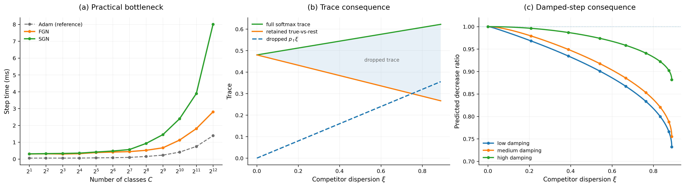
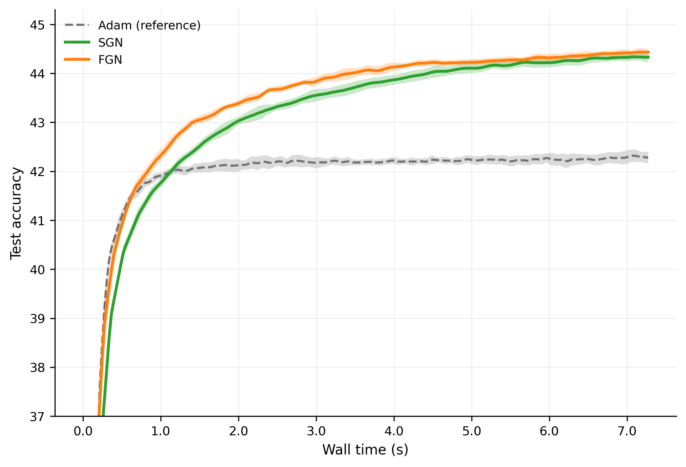
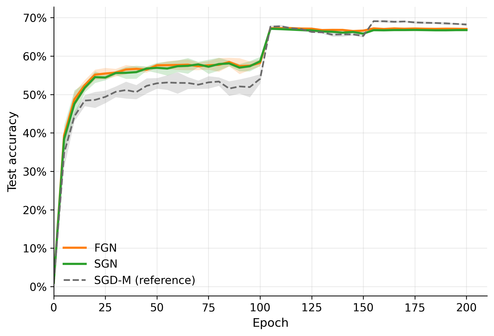

# Fast Gauss-Newton for Multiclass Cross-Entropy


Reproduction scripts for the main figures and experimental results
in "[Fast Gauss-Newton for Multiclass Cross-Entropy](https://arxiv.org/abs/2605.06081)"
by Mikalai Korbit and Mario Zanon (NeurIPS 2026).

The experiments use [Somax](https://github.com/cor3bit/somax), a JAX library
for second-order optimization providing the FGN and SGN implementations.




<p align="center">
  
  
</p>


## Setup

Python 3.11 or 3.12. Install JAX for your hardware first.
For NVIDIA GPUs on Linux with CUDA 13 support (driver >=580):

```bash
git clone https://github.com/cor3bit/fgn.git
cd fgn
python -m venv .venv
source .venv/bin/activate
python -m pip install --upgrade pip
python -m pip install "jax[cuda13]"
python -m pip install -r requirements.txt
python -c "import jax; print(jax.devices())"
```

For other accelerators, follow the [JAX installation guide](https://docs.jax.dev/en/latest/installation.html).


Cars196 extraction also needs `torch` and `torchvision`. Use the
[PyTorch installer](https://pytorch.org/get-started/locally/) for GPU extraction, or install CPU wheels:

```bash
python -m pip install torch torchvision --index-url https://download.pytorch.org/whl/cpu
```


## Run

Check the pipeline with synthetic inputs, JIT enabled, and no downloads:

```bash
python reproduce_results.py --smoke
```

Run the experiments:

```bash
python reproduce_results.py --figures 1
python reproduce_results.py --figures 2 --stage prepare
python reproduce_results.py --figures 2 --stage run
python reproduce_results.py --figures 3
```

Cars196 features are extracted once. 
PyTorch uses CUDA for extraction if available,
otherwise CPU, independently of the JAX `--device` setting. 
Training defaults to GPU.
The CIFAR-100 dataset is downloaded automatically on the first run.
`python reproduce_results.py` runs everything, 
including missing feature extraction.


| Folder | Experiment | Paper output | Default runs |
| --- | --- | --- | --- |
| `figure1/` | Update cost and curvature mechanism checks | Paper Figure 2 | 3 methods x 12 class counts x 5 seeds; two deterministic panels |
| `figure2/` | Cars196, frozen ResNet-50 features and affine head | Paper Figure 3(a), summary CSVs | 3 methods x 10 seeds, 150 epochs |
| `figure3/` | ResNet-20 on CIFAR-100 | Paper Figure 3(b), aggregate CSV | 3 methods x 5 seeds, 200 epochs |


Defaults are in
`figure1/configs.py`, `figure2/configs.py`, and `figure3/runner.py`.


Useful controls:

```bash
python reproduce_results.py --dry-run
python reproduce_results.py --figures 3 --seeds 1
python reproduce_results.py --stage plot
python reproduce_results.py --figures 2 --stage run --feature-cache /path/to/features.npz
python reproduce_results.py --figures 1 --artifacts-dir /path/to/new-run
```


`--stage plot` rebuilds figures and summary CSVs without training. Experiments 1/2
refuse existing results; choose a new `--artifacts-dir` or explicit `--overwrite`.
Experiment 3 reuses matching completed runs, can add seeds, and restarts failed
runs from scratch. There is no checkpoint resume. Use one process per artifact directory.


Everything generated or downloaded goes under `artifacts/` by default:

| Directory | Contents |
| --- | --- |
| `data/`, `cache/` | CIFAR data, Cars196 download cache, pretrained weights, library caches |
| `features/` | Reusable Cars196 feature cache and preprocessing metadata |
| `figure1/`, `figure2/`, `figure3/` | Raw records, summaries, PNG/PDF plots |
| `figure2/derived/`, `figure3/aggregate.csv` | Per-method summaries as CSV |
| `manifests/` | Commands, package versions, source hashes, and execution status |
| `smoke/` | Separate outputs from synthetic checks |


## Citation

```bibtex
@article{korbit2026fast,
  title={Fast Gauss-Newton for Multiclass Cross-Entropy},
  author={Korbit, Mikalai and Zanon, Mario},
  journal={arXiv preprint arXiv:2605.06081},
  year={2026}
}
```


## License

Apache-2.0
